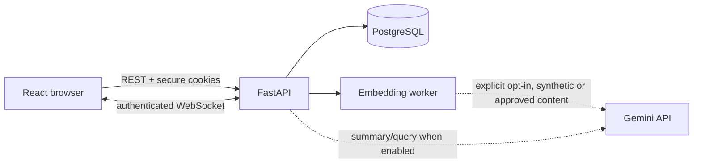

# ConnectHub

ConnectHub is an end-to-end real-time messaging platform with secure session-based authentication, persistent WebSocket communication, AI-powered conversation summaries, and embedding-based semantic search. It is designed as a defensible AI application-engineering portfolio: the provider boundary, asynchronous job recovery, privacy gates, and retrieval evaluation are visible and reproducible rather than hidden behind a demo.

> Local application verification is complete. AI remains disabled by default. Controlled staging is a conditional owner decision; public production has not been authorized or run.

The central engineering challenge is coordinating durable PostgreSQL state with process-local real-time delivery while making optional external AI processing explicit, bounded, version-compatible, and measurable.

## Portfolio evidence

- [System architecture](docs/diagrams/01-system-architecture.md) and [architecture decisions](docs/architecture-decisions/README.md)
- [AI evaluation methodology and measured offline baseline](docs/AI_EVALUATION.md)
- [Synthetic dataset specification](docs/AI_DATASET.md)
- [Security review](docs/SECURITY_REVIEW.md) and [privacy/data flow](docs/PRIVACY_DATA_FLOW.md)
- [Demo script](docs/DEMO_SCRIPT.md), [interview preparation](docs/INTERVIEW_PREP.md), and [project freeze](docs/PROJECT_FREEZE.md)
- [Current handoff](docs/PROJECT_HANDOFF.md) and [release readiness](docs/RELEASE_READINESS.md)

Actual portfolio screenshots were **NOT CAPTURED in the AI-evaluation milestone** because the local services were intentionally left stopped and no disposable demo database was authorized. The UI was previously verified through three authenticated Playwright scenarios; screenshot capture remains an owner-run demo step and is not represented by mockups.



### AI pipeline, honestly scoped

Stored messages use Gemini's `RETRIEVAL_DOCUMENT` task and searches use `RETRIEVAL_QUERY`. A versioned embedding profile prevents incompatible spaces from mixing. JSONB vectors are ranked with exact cosine similarity only inside a newest-first candidate window; this is not a global vector index and not a complete RAG system. Ordinary messaging never needs AI, and disabled AI does not create a future external-processing backlog.

The source-controlled synthetic benchmark contains 120 messages, 60 queries, graded relevance judgments, and 18 summary fixtures. Deterministic exact-substring baseline metrics are measured; live Gemini retrieval and summary-quality scores remain **NOT RUN** until the owner explicitly supplies an approved process environment and authorizes synthetic-only provider calls.

## Stack

- Python 3.12-compatible FastAPI backend (locally verified with Python 3.13)
- SQLAlchemy 2.1 async access, Psycopg 3, Alembic, PostgreSQL, and Uvicorn with `websockets`
- React 19, TypeScript 6, Vite 8, Tailwind CSS 4
- Pytest, Ruff, Vitest, React Testing Library, ESLint
- GitHub Actions

## Repository structure

```text
backend/       FastAPI foundation, models, migrations, and tests
frontend/      React/Vite application, design system, real-time client, and tests
docs/          Requirements, architecture, contracts, security, roadmap, handoff
.github/       Continuous-integration workflow
AGENTS.md      Permanent instructions for future Codex tasks
```

## Prerequisites

- Windows PowerShell
- Python 3.12 or 3.13 (the current machine uses 3.13)
- Node.js 22.13+ or 24 and npm
- PostgreSQL 18 recommended for local parity; another supported current release must be verified
- A dedicated development database and a separate disposable database whose name ends in `_test`

PostgreSQL 18.7 is installed locally. Never substitute SQLite for PostgreSQL integration tests.

## Windows PowerShell setup

```powershell
Set-Location <path-to-your-connecthub-clone>
py -3.13 -m venv .venv
.\.venv\Scripts\Activate.ps1
python -m pip install -r .\backend\requirements.lock
Set-Location .\frontend
npm ci
Set-Location ..
```

Python 3.12 users may replace `py -3.13` with `py -3.12`.

On this machine, Windows Application Control blocks optional native Python extensions. SQLAlchemy 2.1.8 is therefore installed from source without its optional C extension, and Psycopg uses its official pure-Python implementation with PostgreSQL's system `libpq`. Do not change machine-wide policy or PATH. For each backend shell, use process-local settings:

```powershell
$env:PATH = "C:\Program Files\PostgreSQL\18\bin;$env:PATH"
$env:PSYCOPG_IMPL = "python"
```

If reinstalling SQLAlchemy on this specific machine, install the lock first and then rebuild the same pinned version without the optional extension:

```powershell
$env:DISABLE_SQLALCHEMY_CEXT = "1"
python -m pip install --force-reinstall --no-binary SQLAlchemy --no-deps SQLAlchemy==2.1.8
```

## Environment configuration

Copy `.env.example` to `.env` and replace every placeholder locally. Never commit `.env`.

```powershell
Copy-Item .env.example .env
```

- `DATABASE_URL` must use `postgresql+psycopg://` and target the development database.
- `TEST_DATABASE_URL` must target a different, disposable database whose name ends in `_test`.
- Reserved characters in URL credentials must be percent-encoded. For example, an `@` inside a password must not appear raw in the URL.
- `ALLOWED_ORIGINS` is a JSON array of explicit origins; wildcard credentialed CORS is rejected.
- `CSRF_SECRET` is required at API startup, must be a non-placeholder value of at least 32 characters, and must never be committed.
- `COOKIE_SECURE=true` is mandatory in production. Local loopback HTTP development may use `false`.
- Session lifetime, cookie names, and the single-process rate limits are environment-configurable; see `.env.example`.
- AI is disabled by default. `AI_ENABLED=true` plus a local `AI_API_KEY` enables Gemini summaries and embedding processing; normal messaging remains available without a key.

The backend resolves `.env` from the repository root using the absolute path derived from `backend/app/core/config.py`. Configuration therefore does not depend on starting Python from the repository root or `backend` directory.

## Database migrations

Run migrations only after positively verifying `DATABASE_URL`. Never point these commands at an unknown or production database.

```powershell
Set-Location .\backend
..\.venv\Scripts\python.exe -m alembic current
..\.venv\Scripts\python.exe -m alembic upgrade head
Set-Location ..
```

## Run the backend foundation

```powershell
Set-Location .\backend
..\.venv\Scripts\python.exe .\run.py
```

The launcher keeps the existing `app.main:app` entry point and selects the Windows event loop required by Psycopg's pure-Python async implementation.

- `GET http://127.0.0.1:8000/health/live` checks process liveness.
- `GET http://127.0.0.1:8000/health/ready` checks PostgreSQL connectivity and returns only safe status.

## Local development quick start

PowerShell 7 (`pwsh`) is preferred. The lifecycle script is also verified with Windows PowerShell 5.1. Open this owner checkout in VS Code with:

```powershell
cd "D:\_Rehan\Project_Python_Chat_system"
code .
```

Start both the FastAPI backend and Vite frontend from one terminal:

```powershell
cd "D:\_Rehan\Project_Python_Chat_system"
.\scripts\connecthub-dev.ps1 start
```

After `start` reports success, open the frontend at <http://127.0.0.1:5173> and check backend readiness at <http://127.0.0.1:8000/health/ready>. The command succeeds only after the frontend root, backend liveness/readiness, and frontend-proxied readiness all respond successfully.

Check or stop the application safely:

```powershell
.\scripts\connecthub-dev.ps1 status
.\scripts\connecthub-dev.ps1 stop
```

The script uses the project virtual environment and frontend installation, starts both services on `127.0.0.1`, supplies the Windows Psycopg/libpq requirements only to the child backend process, and generates an ephemeral CSRF secret without printing or storing it. It does not edit `.env`, run migrations, install dependencies, or enable AI. AI remains disabled by default.

If port 8000 or 5173 is occupied, `start` refuses to continue and identifies the listener. Do not terminate an unrelated process; stop that application yourself or retry after the port becomes available. `stop` reads ignored `.runtime/` state, verifies process identity, and only terminates processes created by this lifecycle script. The owner does not need to start Uvicorn or Vite manually, set environment variables, or modify either database for normal local launch.

## Implemented backend API

The REST base path is `/api/v1`. Public registration and login require an allowed `Origin` and JSON content type. Authenticated mutations require the HttpOnly session cookie plus the readable `connecthub_csrf` cookie echoed in `X-CSRF-Token`.

- `POST /auth/register`, `POST /auth/login`, `POST /auth/logout`
- `GET/PATCH /users/me`, `GET /users/me/rooms`, `GET /users/me/invitations`
- `GET/POST /rooms`, `GET/DELETE /rooms/{room_id}`
- `POST/DELETE /rooms/{room_id}/membership`
- room members, owner removal, private-room invitations, and invitation accept/decline/revoke
- message create/history/text search, read position, and read receipts
- persistent notification list/count/read/read-all
- AI summary, semantic-search, embedding status, and owner backfill routes
- authenticated `/ws` and `/ws/rooms/{room_id}` WebSockets

Room creation atomically creates the owner membership. Owners cannot leave or be removed, and only the owner may permanently delete the room. Public discovery excludes private rooms. Message sends lock membership, commit to PostgreSQL before broadcast, and support per-sender/per-room idempotency keys. WebSockets authenticate the existing session cookie and validate `Origin`; the connection registry and presence model are intentionally single-process.

The complete route and event contract, including status codes and authorization rules, is in `docs/api-contract.md`.

## Run the frontend application

```powershell
Set-Location .\frontend
npm run dev
```

Vite serves `http://127.0.0.1:5173` when launched with `npm run dev -- --host 127.0.0.1 --port 5173`; it proxies `/api`, `/health`, and `/ws` to `http://127.0.0.1:8000`.

The client restores cookie-backed sessions, implements registration/login/logout and profile updates, supports public discovery and private invitations, renders joined rooms and persistent history, sends messages with stable client idempotency keys, and consumes the shared authenticated WebSocket with bounded reconnection. Notifications, read/typing/presence state, exact and semantic search, summaries, and embedding status are integrated. AI features surface an honest unavailable state when the provider is disabled.

Backend authorization remains authoritative. The client includes credentials on API requests, echoes the readable CSRF cookie for unsafe methods, renders message content as plain React text, and never places session credentials in browser storage.

## Backend checks

```powershell
Set-Location .\backend
..\.venv\Scripts\python.exe -m ruff check .
..\.venv\Scripts\python.exe -m ruff format --check .
..\.venv\Scripts\python.exe -m pytest -m "not integration"
..\.venv\Scripts\python.exe -m pytest -m integration
..\.venv\Scripts\python.exe -m pytest
```

The integration command requires a safe `TEST_DATABASE_URL` and executes the Alembic migration against real PostgreSQL. It refuses unsafe targets.

Run backend tests from `backend`, as shown above. The backend's `pyproject.toml` owns test discovery and import configuration; the repository root intentionally has no Python project manifest.

## Frontend checks

```powershell
Set-Location .\frontend
npm run lint
npm run typecheck
npm test
npm run build
npm run e2e
```

Vitest mocks REST/WebSocket boundaries. The separate Playwright suite uses the guarded PostgreSQL `_test` database and real frontend/backend/WebSocket stack; it cleans the test database before and after, and must never target development or production.

## Release and operations

The portable single-worker deployment example is `compose.production.example.yml`. Review `docs/RELEASE_READINESS.md`, `docs/SECURITY_REVIEW.md`, `docs/DEPLOYMENT.md`, `docs/OPERATIONS.md`, `docs/BACKUP_RESTORE.md`, and `docs/PRIVACY_DATA_FLOW.md` before any hosting work. No public deployment is performed by the repository setup commands.

Current provider research and the exact approval gates are in `docs/STAGING_OPTIONS.md` and `docs/PRODUCTION_OWNER_ACTIONS.md`. The current recommendation is a paid, one-instance Render Singapore pilot for lowest cost, with DigitalOcean Bangalore plus Managed PostgreSQL as the India-region alternative. These are recommendations only; no provider account or resource has been created.

## Git workflow

Inspect `git status` before work, use a focused branch when authorized, preserve unrelated changes, and review diffs. Do not stage, commit, reset, clean, or push unless the current task explicitly authorizes it.

## Design documentation

- [Requirements](docs/requirements.md)
- [Architecture](docs/architecture.md)
- [Database design](docs/database-design.md)
- [API and WebSocket contract](docs/api-contract.md)
- [Security design](docs/security-design.md)
- [Development roadmap](docs/development-roadmap.md)
- [Project handoff](docs/PROJECT_HANDOFF.md)

