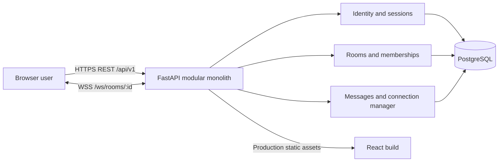
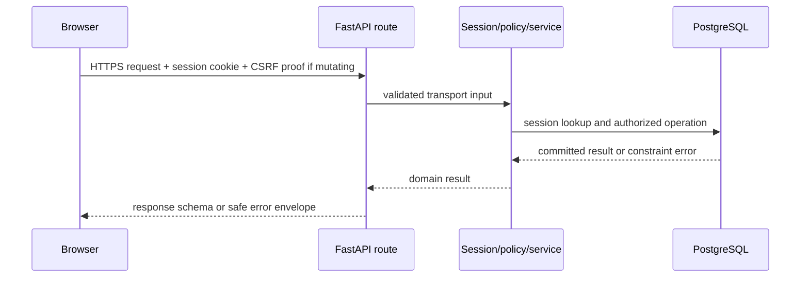
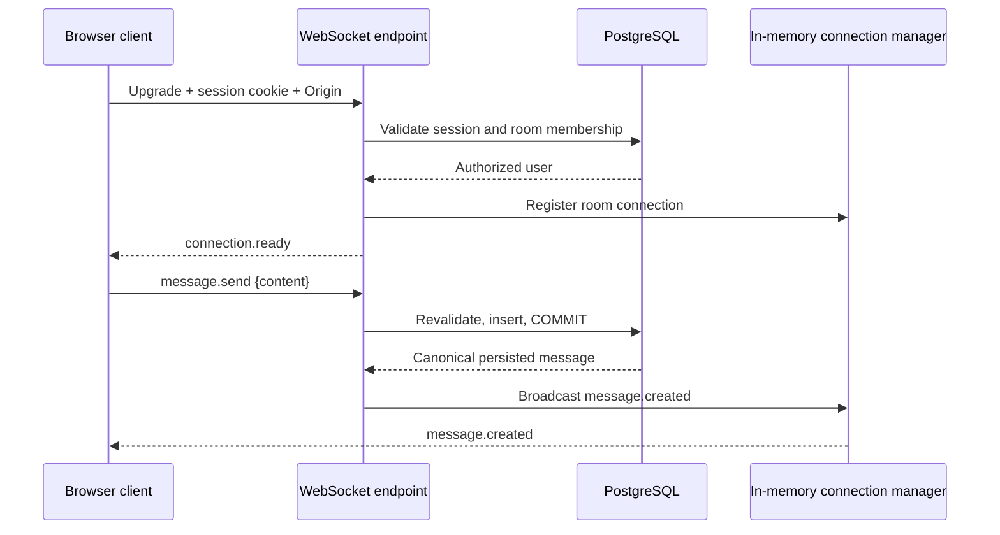
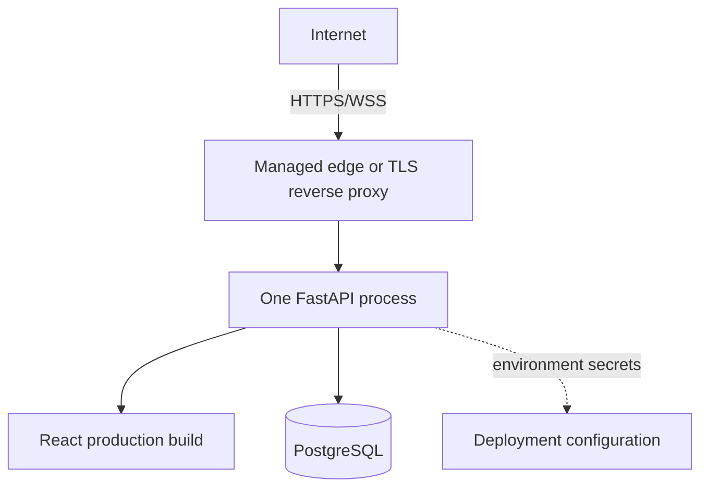

# ConnectHub Architecture Specification

| Metadata | Value |
|---|---|
| Project | ConnectHub |
| Document title | Architecture Specification |
| Status | Draft — Pending Project Owner Review |
| Version | 0.1 |
| Date of preparation | 2026-11-16 |

## 1. System overview

ConnectHub is a modular monolith: one FastAPI application contains cohesive identity, room, membership, and messaging modules; PostgreSQL is authoritative; a React/TypeScript client uses REST for ordinary operations and WebSockets for live messages. The boundaries are logical and testable, not independently deployed services.



## 2. Why a modular monolith

One deployable backend minimizes configuration, network failure modes, memory use, and debugging overhead on the target laptop. Modules still separate responsibilities and can be tested independently. Microservices would add discovery, distributed authorization, cross-service transactions, and observability without a demonstrated scale need. Redis/Kafka are likewise deferred until measured multi-instance requirements exist.

## 3. Boundaries and responsibilities

### Frontend

The React application owns presentation: authentication/profile forms; public and joined-room views; room creation/membership controls; history and message composer; WebSocket lifecycle; deduplication; loading/empty/error/connection states; responsive and accessible interaction. It may hide unavailable actions for usability, but is never trusted to authorize them.

Implemented organization:

```text
frontend/src/
  app/          routing, providers, application shell
  features/     auth, profile, rooms, chat, notifications, search, dashboard
  lib/          typed REST client, errors, formatting, async feature hook
  realtime/     WebSocket client, reconnection, event parsing
  components/   reusable accessible primitives and icon system
  types/        REST and WebSocket transport shapes
  *.test.tsx    deterministic integration-style UI tests with mocked boundaries
```

Server reads use a small abort-aware feature hook where reuse is valuable; auth and real-time connection state use focused React contexts. Transient composer, pagination, modal, search, and room state remains local. No global state or routing dependency was added because the implemented history router and contexts satisfy current scale.

One root `/ws` connection is created only for an authenticated session. Room pages subscribe/unsubscribe through that connection; reconnect uses bounded exponential backoff with jitter, subscriptions are replayed on open, and malformed events are ignored. HTTP remains the authoritative send path and client UUIDs preserve idempotent retry. Message bodies render as React text, not injected HTML.

### Backend

```text
backend/app/
  main          application factory, middleware, routes, static delivery
  config        validated settings
  db            engine, session lifecycle, base metadata
  identity      users, password verification, sessions, profile
  rooms         rooms, memberships, owner policies
  messaging     history, message creation, connection manager
  api           /api/v1 routers, schemas, error mapping
  websocket     handshake, protocol schemas, lifecycle
  security      cookies, CSRF, origins, rate limits
```

Each feature should have narrowly scoped schemas, policies/services, and persistence queries. Route handlers translate transport inputs/outputs; they should not contain raw SQL or duplicate authorization rules. ORM entities model persistence, not HTTP responses. No inheritance hierarchy is required.

## 4. Database interaction and transactions

SQLAlchemy 2.x uses one consistent asynchronous PostgreSQL approach. Request/socket handlers obtain bounded database sessions. Service operations define transaction boundaries; repositories/query functions perform parameterized persistence. Alembic owns schema evolution.

Critical transactions include:

- Room creation inserts the room and exactly one owner membership atomically.
- Message handling locks the current membership row with `SELECT ... FOR UPDATE`, validates it, inserts the message, commits, refreshes the canonical result, then broadcasts. Membership removal acquires the same conflicting row lock so send/removal ordering is deterministic.
- Room deletion authorizes the owner and deletes the room with dependent memberships/messages under the approved policy.

PostgreSQL constraints remain the last line of defense against races; application validation produces clearer errors but cannot replace constraints.

## 5. HTTP request flow



Middleware assigns request context and applies safe headers/logging. Authentication reads and hashes the opaque cookie token, then requires a live, unrevoked session. Authorization is operation-specific and occurs before protected data is returned.

## 6. WebSocket flow



The client supplies no trusted sender identity. Invalid frames return protocol errors and may close the socket. Cleanup removes disconnected sockets. Logout, session expiry, membership removal, and room deletion invalidate authorization; local affected connections are closed where identifiable, and incoming operations are checked against current state. After interruption, REST history is the recovery path. Exactly-once delivery is not claimed.

## 7. Authentication architecture

Registration normalizes identifiers and hashes passwords with Argon2id. Login verifies credentials, generates a cryptographically secure token with at least 256 bits of entropy, stores only its lowercase SHA-256 hexadecimal digest in `auth_sessions`, and sends the raw token in an HttpOnly cookie. Recommended initial expiry is seven days, configurable. Logout is idempotent, revokes a valid current row when present, clears both session and CSRF cookies, and closes identifiable local sockets.

Cookie-authenticated state changes use a signed session-bound double-submit token: a random nonce is signed with HMAC-SHA256 using a dedicated CSRF secret and current-session binding, placed in a readable SameSite=Lax cookie, echoed in `X-CSRF-Token`, compared, signature-verified, and Origin-checked. Registration/login instead require strict pre-authentication Origin and content-type validation. Production session cookies are Secure, HttpOnly, SameSite=Lax, host-only, scoped to `/`, and explicitly expired on logout. Development may omit `Secure` only over local HTTP. WebSockets use the session cookie, an explicit Origin allowlist, session validation, and room-membership validation before acceptance—never query-string tokens.

## 8. Data flow and authoritative state

- PostgreSQL: users, sessions, rooms, memberships, messages, timestamps, and roles.
- Backend memory: only current socket objects and process-local defensive counters/caches; never durable truth.
- Frontend memory: rendered/query state and transient interaction state; it reconciles by UUID.
- REST: account, rooms, memberships, and history.
- WebSocket: committed live message events and connection/protocol errors.

Normalization occurs at input boundaries; database uniqueness uses normalized/case-insensitive semantics. API schemas explicitly exclude `password_hash` and `token_hash`.

## 9. Deployment architecture



Production should be same-origin where practical: the FastAPI deployment serves or fronts the built client and exposes API/WebSocket paths. Development prefers Vite proxies for `/api`, `/health`, and `/ws`; if cross-origin access is needed, credentialed CORS uses explicit origins and never a wildcard. The provider, TLS termination, backups, and exact process model are Task 7 decisions based on then-current facts.

## 10. Reliability and scalability

Reliability controls include transactions, constraints, migration review, bounded inputs, pagination, cleanup in `finally`, safe retries only where idempotent, health checks, structured sanitized logs, and database backups appropriate to the chosen provider. The UI treats WebSocket delivery as interruptible and uses bounded exponential reconnect backoff with jitter, followed by history reconciliation.

The in-memory connection manager works only inside one process. Multiple workers/instances have disjoint client lists and would miss cross-process broadcasts. The MVP must therefore run one appropriately configured backend process. This is an honest availability and throughput limitation. Redis Pub/Sub or another broker is a future option only after measurement; it is not part of the MVP.

No performance or simultaneous-user guarantee is made before load measurement. Queries and pools must be conservative for 8 GB development hardware.

## 11. Technology decisions and trade-offs

| Decision | Reason | Trade-off |
|---|---|---|
| FastAPI + native WebSockets | One typed Python web stack | Async lifecycle requires discipline |
| SQLAlchemy 2.x async + Alembic | Explicit persistence and migrations | Compatibility must be checked in Task 2 |
| PostgreSQL | Correct constraints/indexes and production parity | Requires a real local/test service |
| Opaque DB sessions, not JWT | Immediate revocation and simple browser model | Database lookup per authentication path |
| React + TypeScript + Vite | Typed component client and fast development | Separate dev origin requires restricted CORS |
| Tailwind CSS | Consistent responsive styling | Class-heavy markup; avoid unnecessary plugins |
| UUID identifiers | Non-sequential public identifiers | Wider indexes and no semantic timestamp ordering |
| REST + WebSocket | Clear recovery vs live-delivery roles | Shared schemas must stay consistent |

Exact package versions are deliberately absent until compatibility verification in Task 2.

## 12. Educational mapping

| Educational model | Professional ConnectHub form |
|---|---|
| `Message` object | Persistent `messages` row plus messaging service and response schema |
| `User` object | `users` entity plus identity/session services |
| `ChatRoom` object | `rooms` entity plus room/membership policies |
| `User.chatroom` | Many-to-many `room_memberships` rows |
| `ChatRoom.users` list | Constrained membership query |
| `ChatRoom.messages` list | Indexed persistent history query |
| Class counter | Database UUID |
| Python sender reference | `sender_id` foreign key; sender derived from session |
| `print()` | REST response or WebSocket event rendered by the frontend |

The learning concepts remain visible, but durable data, transport, authorization, and presentation are separated. Extra inheritance or abstract factories would obscure rather than improve this design.

## 13. Assumptions and unresolved items

This draft assumes public-room discovery, one owner for the room lifetime, and no ownership transfer. Owner-controlled transactional hard deletion of live room, membership, and message rows is APPROVED; future UI must confirm it, while provider backup retention remains a Task 7 concern with no immediate-erasure guarantee. Task 2 verifies compatible dependencies and records implementation choices.

Health is split: `/health/live` reports process liveness without touching PostgreSQL; `/health/ready` performs a lightweight database check and exposes no credentials or detailed connection exception.

## 14. Current implementation snapshot

Tasks 2 and 3 implement the FastAPI modular-monolith foundation with SQLAlchemy 2.1.8 async APIs, Psycopg 3.3.9, Alembic 1.20.1, Argon2id identity services, hashed opaque database sessions, CSRF/origin controls, own-profile operations, and public-room/membership services. The Windows development process uses Psycopg's pure-Python implementation with PostgreSQL system `libpq`; no system policy is weakened.

Room creation commits the room and initial owner membership together. Membership removal and message send share `lock_membership_for_update`, which acquires the target membership row with `SELECT ... FOR UPDATE`; the protected decision and mutation remain in the same transaction. Room discovery and user memberships use bounded stable cursors. Owner-controlled hard deletion relies on the existing dependent-row cascades.

Message history/send, private rooms/invitations, notifications, read/typing/presence events, authenticated WebSockets, AI summaries, and semantic search are implemented across the backend and React client. PostgreSQL is authoritative and messages commit before broadcast. A bounded in-process connection manager supports multiple tabs/devices, while rate limits, live broadcast, and presence intentionally require a single backend process. The frontend honors unavailable/partial states instead of simulating unsupported server capabilities.

Release hardening adds owner-authorized durable sent-invitation recovery, environment-aware browser security headers, PostgreSQL-backed Playwright journeys, automated desktop/mobile accessibility checks, a bounded local load smoke, and a portable Nginx/FastAPI/PostgreSQL single-worker topology. This does not change the modular-monolith or single-process real-time constraint.

AI integration is provider-abstracted with a Gemini HTTP adapter. Summaries are bounded and cached by source fingerprint. Every committed message creates a durable embedding job; the background worker claims jobs with `FOR UPDATE SKIP LOCKED`, retries safely, and persists provider/model/dimension metadata. Because pgvector is not installed on the verified PostgreSQL instance, embeddings use JSONB and semantic search performs exact cosine ranking over a bounded, room-scoped candidate set. This is correct for the local MVP, not a claim of large-scale vector-index performance.
## AI correctness addendum (implemented 2026-11-17)

Gemini document and query embeddings now use distinct retrieval task types inside a shared versioned profile. Migration `20261117_0003` marks pre-existing vectors/jobs as legacy rather than mixing them with the active space. AI-disabled messaging creates no embedding job; automatic new-message indexing and historical owner backfill have separate explicit gates. The worker performs periodic profile-scoped stale recovery, bounded durable failure transitions, and vector validation. Semantic ranking remains exact cosine only within a newest-first candidate window; see `diagrams/06-ai-pipeline.md` and ADRs 004–006.
