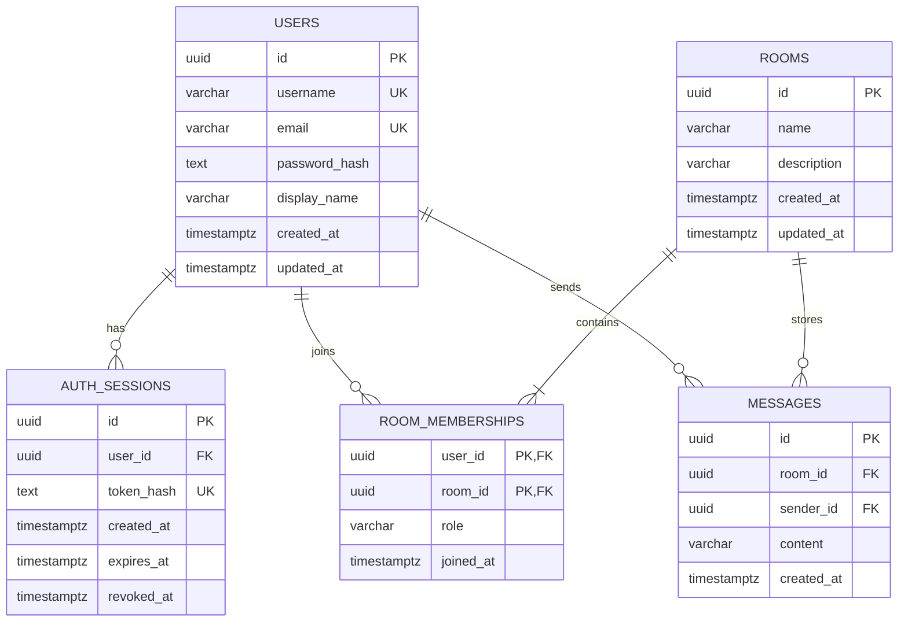

# ConnectHub Database Design

| Metadata | Value |
|---|---|
| Project | ConnectHub |
| Document title | Database Design |
| Status | Draft — Pending Project Owner Review |
| Version | 0.1 |
| Date of preparation | 2026-11-16 |

## 1. Scope and conventions

PostgreSQL is the durable source of truth. The initial schema has exactly five entities: `users`, `auth_sessions`, `rooms`, `room_memberships`, and `messages`; revision `20261116_0002` adds the complete-backend support tables documented in section 10, and revision `20261117_0003` adds AI profile/cache safety metadata. Identifiers are UUIDs. Timestamps use timezone-aware PostgreSQL values and represent UTC instants.

String inputs are Unicode-normalized according to one documented policy, trimmed where applicable, and validated before insertion. Username/email uniqueness must also be enforced in PostgreSQL using normalized columns/expressions or a case-insensitive type; application prechecks improve messages but do not prevent races.

## 2. Entity definitions

### `users`

| Column | Proposed PostgreSQL type | Null | Rules |
|---|---|---:|---|
| `id` | `uuid` | No | Primary key |
| `username` | `varchar(50)` | No | Normalized; case-insensitively unique |
| `email` | `varchar(320)` | No | Normalized to lowercase policy; case-insensitively unique |
| `password_hash` | `text` | No | Argon2id encoded hash; never exposed |
| `display_name` | `varchar(100)` | No | Trimmed, 1–100 characters |
| `created_at` | `timestamptz` | No | Creation instant |
| `updated_at` | `timestamptz` | No | Updated on mutation |

The final migration must choose and test one database-level case-insensitive strategy. If expression indexes on `lower(...)` are used, normalization and Unicode expectations must be documented; application and database behavior must agree.

### `auth_sessions`

| Column | Type | Null | Rules |
|---|---|---:|---|
| `id` | `uuid` | No | Primary key |
| `user_id` | `uuid` | No | FK → `users.id` |
| `token_hash` | `varchar(64)` | No | Unique lowercase SHA-256 hexadecimal digest of a ≥256-bit random token; never raw token |
| `created_at` | `timestamptz` | No | Creation instant |
| `expires_at` | `timestamptz` | No | Must be later than creation |
| `revoked_at` | `timestamptz` | Yes | Non-null means unusable |

One user may have many sessions. Authentication performs indexed hash lookup and requires `revoked_at IS NULL` and `expires_at > now`. Recommended initial lifetime is seven days, configurable; cleanup of expired rows is an operational task.

### `rooms`

| Column | Type | Null | Rules |
|---|---|---:|---|
| `id` | `uuid` | No | Primary key |
| `name` | `varchar(100)` | No | Trimmed, 1–100 characters; not globally unique |
| `description` | `varchar(500)` | No | Trimmed; empty allowed |
| `created_at` | `timestamptz` | No | Creation instant |
| `updated_at` | `timestamptz` | No | Updated on mutation |

All MVP rooms are public/discoverable, so no visibility column is introduced.

### `room_memberships`

| Column | Type | Null | Rules |
|---|---|---:|---|
| `user_id` | `uuid` | No | FK → `users.id` |
| `room_id` | `uuid` | No | FK → `rooms.id` |
| `role` | constrained text/enum | No | Exactly `owner` or `member` |
| `joined_at` | `timestamptz` | No | Membership creation instant |

Primary key: `(user_id, room_id)`. It prevents duplicate membership and implements the many-to-many relation. Ownership has one authoritative representation: `role='owner'`; `rooms` has no competing `owner_id`.

PostgreSQL should enforce **at most one owner** with a partial unique index on `room_id WHERE role='owner'`. A constraint cannot easily require at least one child row for every parent across all statements. Therefore room creation is one transaction that inserts the room and owner membership; the application forbids owner leave and ownership role mutation; room deletion removes the parent and children atomically. Tests prove every committed room has exactly one owner. Administrative/manual writes must follow the same invariant.

### `messages`

| Column | Type | Null | Rules |
|---|---|---:|---|
| `id` | `uuid` | No | Primary key |
| `room_id` | `uuid` | No | FK → `rooms.id` |
| `sender_id` | `uuid` | No | FK → `users.id` |
| `content` | `varchar(4000)` | No | Trimmed, 1–4,000 characters |
| `created_at` | `timestamptz` | No | Server-controlled creation instant |

The authenticated session determines `sender_id`; clients cannot submit it as trusted data. Membership is checked transactionally at send time. A cross-table rule “sender is a room member” is principally an application policy because historical messages deliberately survive a member leaving.

## 3. Relationships

The `|{` relationship expresses the application invariant that a committed room has at least its owner membership, although PostgreSQL enforcement also depends on the creation transaction and restricted mutation path.

## 4. Constraints and indexes

| Object | Constraint/index | Purpose |
|---|---|---|
| `users` | PK `id` | Identity |
| `users` | unique case-insensitive username expression/value | Registration and lookup integrity |
| `users` | unique case-insensitive email expression/value | Registration/login integrity |
| `auth_sessions` | PK `id`; unique `token_hash` | Session identity and lookup |
| `auth_sessions` | index `(user_id)` and cleanup index `(expires_at)` | User revocation/connection handling and expiry cleanup |
| `auth_sessions` | check `expires_at > created_at` | Valid lifetime |
| `rooms` | PK `id`; index `(created_at DESC, id DESC)` | Stable public discovery pagination |
| `room_memberships` | PK `(user_id, room_id)` | User-room uniqueness and “my rooms” lookup |
| `room_memberships` | index `(room_id, user_id)` | Room membership checks/listing |
| `room_memberships` | index `(user_id, joined_at DESC, room_id DESC)` | Stable joined-room pagination |
| `room_memberships` | check role in `owner`,`member` | Role integrity |
| `room_memberships` | partial unique `(room_id) WHERE role='owner'` | At most one owner |
| `messages` | PK `id`; index `(room_id, created_at DESC, id DESC)` | Stable room history |
| `messages` | content length/check after trim | Non-empty, bounded content |

The exact expression/check syntax must be validated against PostgreSQL during Task 2. Indexes should be confirmed with representative query plans rather than multiplied speculatively.

## 5. Referential integrity and deletion

| Relationship | Proposed behavior | Reason |
|---|---|---|
| Session → user | `ON DELETE CASCADE` | Deleted account cannot retain sessions |
| Membership → user | Restrict account deletion initially or use a future explicit account-deletion workflow | Avoid accidental loss/inconsistent ownership |
| Membership → room | `ON DELETE CASCADE` | Room deletion removes membership |
| Message → room | `ON DELETE CASCADE` | Approved MVP hard deletion removes history |
| Message → sender | `ON DELETE RESTRICT` initially | Preserve message attribution; account deletion needs a later product policy |

A normal leave deletes only the membership; messages remain. A former member cannot query them unless they rejoin. An owner cannot leave. Owner deletion of a room hard-deletes memberships and messages in one operation.

**APPROVED irreversible decision:** owner-authorized room deletion transactionally removes the live room, memberships, and messages. A later frontend must require destructive confirmation. Provider backup retention is separate, so live deletion does not promise immediate erasure of every backup. Account deletion remains outside the MVP and needs a separate retention/anonymization decision.

## 6. History pagination

Canonical order is `(created_at DESC, id DESC)`. UUID is a deterministic tie-breaker, not a time source.

- First page: filter by `room_id`, order descending, fetch `limit + 1`, return at most `limit` (default proposed 50, maximum 100).
- Older page: decode an opaque cursor containing the last returned `(created_at, id)` and query rows where `(created_at, id) < (cursor_time, cursor_id)` using the same order.
- Return `next_cursor` only when another row exists. Validate cursor shape and bind it to the documented order.
- The server may return newest-first; the UI can reverse within a page for chronological display while preserving cursor semantics.
- Concurrent inserts newer than the cursor do not reshuffle older pages. Identical timestamps remain stable because `id` breaks ties.
- The client keeps a map/set keyed by message UUID so overlap between REST recovery and WebSocket events does not duplicate rendering.

Cursor contents are positioning data, not authorization. Every page request independently authenticates and verifies current membership.

## 7. Example membership scenario

“Python Lounge” is created in a transaction with Alice’s `(alice_id, room_id, owner)` row. Bob joins with `member`. Alice and Bob can retrieve history, open sockets, and send. Rehan has no row and is denied both history and socket access. Bob may leave: his membership is deleted, his prior messages remain, and access stops until he rejoins. Alice cannot leave; she can delete the room, which—if hard deletion is approved—cascades to memberships and messages.

## 8. Trade-offs and verification

- Composite membership key expresses domain identity without a meaningless surrogate ID, at the cost of composite references if needed later.
- Role-based ownership avoids contradictory `rooms.owner_id`, but “exactly one” requires transaction and mutation-path discipline in addition to a partial unique index.
- UUIDs are safe public identifiers but enlarge indexes; they require the timestamp tie-breaker for history order.
- Retaining messages after leave preserves conversation continuity while authorization remains membership-based.
- Async access supports the FastAPI/WebSocket model but must use one consistent driver/session pattern.
- A real PostgreSQL test database is mandatory; SQLite cannot validate partial indexes, types, concurrency, or PostgreSQL constraint behavior faithfully.

Task 2 must test migrations from empty schema, uniqueness races, owner invariants, multiple memberships, deletion behavior, pagination ties, and production-database safeguards before this draft becomes approved.

Message send/removal concurrency is enforced by both operations locking the same membership row using conflicting PostgreSQL row locks. If send locks first it may commit before removal; if removal commits first the send finds no membership and is rejected. Both orderings are covered against PostgreSQL.

## 10. Complete backend schema extension (`20261116_0002`)

The incremental migration preserves the original revision and adds:

- `users.last_seen_at` for durable last-disconnect state.
- `rooms.visibility` (`public` or `private`) plus a partial public-discovery index.
- `room_memberships.last_read_message_id` and `last_read_at`; the message reference uses `ON DELETE SET NULL`.
- `messages.client_idempotency_key` and a partial unique `(room_id, sender_id, client_idempotency_key)` index.
- `room_invitations` with inviter/invitee/room foreign keys, expiration, response state, and one-pending-invitation uniqueness.
- `notifications` with recipient, optional actor/room/message/invitation references, JSONB metadata, read timestamp, pagination/unread indexes, and optional deduplication key.
- `ai_summaries` with provider/model, source range/count/fingerprint, cached content, and room/source uniqueness.
- `message_embeddings` keyed by message with provider/model/dimensions and JSONB vector data.
- `embedding_jobs` keyed by message with durable pending/processing/completed/failed state, attempts, retry timing, lock timestamp, and claim index.

Room/message deletion cascades remove dependent invitations, notifications where appropriate, summaries, embeddings, and jobs; user references follow the explicit cascade/restrict/set-null policy in the migration. The local server lacks pgvector, so JSONB vectors and bounded exact cosine search are the implemented fallback. Both `connecthub_test` and `connecthub_dev` report head `20261117_0003` and no autogenerate drift.

## 11. Current implementation and verification status

The foundation and extension models, named constraints/indexes, stable history query, and async Alembic environment are IMPLEMENTED. Both `connecthub_dev` and guarded `connecthub_test` are accessible through `connecthub_app` and are at `20261117_0003`. Live PostgreSQL migrations, reflected AI-profile columns, constraint/index behavior, ORM drift checks, rollback, pagination, AI persistence, and integration tests are VERIFIED. The full backend suite most recently passed 93 tests with zero failures or skips.

The partial unique owner index guarantees at most one owner; atomic room creation and restricted owner mutation preserve the minimum-one-owner application invariant. The schema contains the five original domain tables plus `room_invitations`, `notifications`, `ai_summaries`, `message_embeddings`, and `embedding_jobs` (and the Alembic version table). The isolated backup restore rehearsal, not ordinary development/test migration, remains blocked pending an authorized `_restore_test` database.
## AI profile migration (implemented 2026-11-17)

Revision `20261117_0003` adds an embedding `profile` to stored vectors; `profile` and `origin` to durable jobs; and `prompt_version`, `source_truncated`, and `input_characters` to cached summaries. Existing rows are preserved and labelled `legacy:unprofiled` or `legacy-summary-v0`, so they cannot be silently mixed with the active retrieval space. The job claim index begins with profile. The summary uniqueness key includes prompt version. Both local databases reached this revision; Alembic reported no metadata drift.
