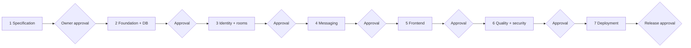

# ConnectHub Development Roadmap

| Metadata | Value |
|---|---|
| Project | ConnectHub |
| Document title | Development Roadmap |
| Status | Draft — Pending Project Owner Review |
| Version | 0.1 |
| Date of preparation | 2026-11-16 |

## 1. Status and operating rules

### Phase 0 — Audit

Completed on 2026-11-16. The intended directory `D:\_Rehan\Project_Python_Chat_system` existed, was empty, and was not a Git repository. No implementation, dependencies, database, frontend, tests, or user changes were present at the Task 1 preflight.

### Phase 1 — Specification

This task creates six draft documents only. It is complete when their consistency audit passes and the project owner reviews them. Draft status is not approval to implement.

Every later task executes sequentially, checks prerequisites before mutation, protects existing work, verifies its own deliverables, reports unrun checks honestly, and stops at its approval checkpoint. A critical prerequisite failure blocks that task rather than triggering an improvised architecture.

## 2. Seven-task execution structure

| Task | Combined phases | Objective | Provisional budget |
|---|---|---|---:|
| 1. Engineering specification | Phase 1 | Establish requirements, architecture, data, contracts, security, and roadmap | 40 min |
| 2. Infrastructure and database | Phases 2 + 3 | Build reproducible foundation and PostgreSQL persistence | 110 min |
| 3. Identity and room management | Phases 4 + 5 | Implement sessions, profiles, rooms, membership, permissions | 140 min |
| 4. Messaging engine | Phases 6 + 7 | Implement persistence, history, WebSockets, recovery | 135 min |
| 5. Complete frontend | Phase 8 | Deliver all user-facing workflows | 90 min |
| 6. Quality and security | Phase 9 | Verify, harden, and correct the integrated MVP | 75 min |
| 7. Production deployment | Phase 10 | Select current hosting and deploy/verify/document | 60 min |

Budgets are planning limits, not completion guarantees or guaranteed Codex allocations.

## 3. Task plans

### Task 1 — Engineering specification (current)

**Prerequisite:** Phase 0 evidence and accessible conflict-free project root.

**Deliverables:** `docs/requirements.md`, `architecture.md`, `database-design.md`, `api-contract.md`, `security-design.md`, and `development-roadmap.md`.

**Acceptance:** all required sections exist; status is draft; the 20 cross-document invariants are checked; irreversible deletion and unknowns are visible; only authorized documentation changed.

**Definition of done:** documentation review completed and file/restriction report supplied. **Approval checkpoint:** owner accepts or requests documentation corrections. Do not start Task 2 automatically.

### Task 2 — Infrastructure and database (Phases 2 + 3)

**Prerequisites:** Task 1 authorization; re-audit of current files/Git; live compatibility check for the approved baselines and actually installed runtimes; deletion policy recorded as APPROVED.

**Objectives and high-level files/modules:**

- Establish Git safely, root project metadata, environment examples (no secrets), README, and permanent root `AGENTS.md` only within this approved task.
- Create `backend/app/{main,config,db,...}`, migrations, backend test configuration, and five SQLAlchemy entities.
- Create `frontend/` Vite React/TypeScript foundation and styling/tool configuration.
- Add Ruff, ESLint, TypeScript, Pytest, Vitest, and GitHub Actions configurations.
- Use one consistent async PostgreSQL path and safe structured logging.

**Required tests/checks:** configuration validation; app startup/lifespan in test context; migration upgrade from empty database and controlled downgrade if supported; case-insensitive identity uniqueness; five-table constraints; multiple memberships; single-owner partial uniqueness; membership uniqueness; referential/deletion behavior; tied-timestamp history index/query; guard against production database targets. Use real PostgreSQL, not SQLite.

**Acceptance/DoD:** reproducible documented setup; clean migrations; schema matches this specification; quality commands and CI run; no secret committed; failures reported. **Checkpoint:** review schema, toolchain, generated files, and test evidence before Task 3.

### Task 3 — Identity and room management (Phases 4 + 5)

**Prerequisites:** approved Task 2 schema/migrations and passing foundation checks.

**Objectives/modules:** implement `identity`, `security`, `rooms`, and `/api/v1` schemas/routes/services: Argon2id registration/login, opaque hashed sessions, cookie/CSRF controls, logout/revocation, own profile, public room discovery, atomic room/owner creation, join/leave, and owner deletion gate.

**Required tests:** normalization and uniqueness races; password non-exposure; invalid/expired/revoked/multi-device sessions; cookie flags; CSRF cases; profile authorization; public discovery; atomic owner creation; duplicate joins; multi-room membership; member leave; owner-leave rejection; owner-only deletion; safe errors and rate limits.

**Acceptance/DoD:** REST contract through room operations is implemented, tested against PostgreSQL, documented, and authorization-reviewed. Irreversible delete is absent/disabled if not approved. **Checkpoint:** demonstrate Alice/Bob/Rehan room access states before messaging.

### Task 4 — Messaging engine (Phases 6 + 7)

**Prerequisites:** approved identity/membership policies and stable session handling.

**Objectives/modules:** implement message service, indexed cursor history, `/api/v1/rooms/{id}/messages`, `/ws/rooms/{id}`, strict events, process-local connection manager, persistence-before-broadcast, cleanup, revocation behavior, client recovery contract, and integration tests.

**Required tests:** cursor first/older pages, maximum limit, equal timestamps, member-only history; allowed/denied handshakes; explicit Origin; fake sender rejection; valid/invalid/over-16-KiB frames; commit before broadcast; commit failure no broadcast; two-client delivery; disconnect cleanup; logout/expiry/membership removal/room deletion; recovery/deduplication; and both message-send versus membership-removal race orderings using conflicting membership-row locks in real PostgreSQL. The one-process limitation remains documented.

**Acceptance/DoD:** the required Alice/Bob/Rehan integration scenario passes using PostgreSQL, REST and WebSocket message schemas match, and no exactly-once/multi-worker claim is made. **Checkpoint:** owner reviews protocol behavior and evidence before UI integration.

### Task 5 — Complete frontend (Phase 8)

**Status (2026-11-17): COMPLETE / VERIFIED locally.**

**Prerequisites:** approved, stable REST/WebSocket contracts and usable backend test environment.

**Objectives/modules:** implement app shell/routing, typed API client, auth/profile, room discovery/creation/membership, joined-room navigation, history, composer, live events, connection status, bounded reconnection, ID deduplication, and responsive accessible states. Avoid Redux unless evidence demonstrates a need.

**Required tests:** registration/login/logout; protected navigation; profile; discover/create/join/leave; room selection; history rendering/pagination; send/live receive; duplicate suppression; loading/empty/error states; terminal vs retryable reconnect behavior; keyboard/accessible labels; representative mobile/desktop layout verification.

**Acceptance/DoD:** all MVP journeys work against the backend, authorization remains server-side, unsafe message HTML is never rendered, frontend checks pass, and screenshots/demo evidence may be added to later documentation. **Checkpoint:** owner reviews UX before hardening.

Implemented evidence: responsive authentication and application shells; profile, discovery, room creation/membership/invitations, history/composer, notifications, search, AI/status, and room-management views; one authenticated root WebSocket with room subscriptions and bounded reconnect; plain-text message rendering; loading/empty/error states; 17 deterministic frontend tests; lint, typecheck, production build, and zero-vulnerability npm audits. Browser verification covers the live public auth flow, local validation, desktop/mobile presentation, overflow, console state, and removal of the legacy foundation page. The later hardening milestone added three passing authenticated PostgreSQL-backed Playwright scenarios covering multi-user authorization, public/private room flows, WebSockets, idempotency, durable invitations, search, AI-disabled behavior, accessibility, and bounded load smoke using only the guarded test database.

### Task 6 — Quality and security (Phase 9)

**Prerequisites:** integrated backend and frontend feature-complete in a protected working tree.

**Objectives:** trace requirements to tests; run unit, PostgreSQL integration, API, WebSocket, frontend, and focused end-to-end suites; conduct authorization, CSRF, Origin, redaction, configuration, dependency, accessibility, reliability, and performance-smoke reviews; correct in-scope defects.

**Required evidence:** exact commands/results; requirement/test matrix; migration-from-clean result; safe production-config failures; sanitized log review; dependency findings; unresolved risk register; resource measurements appropriate to the laptop. No invented scale benchmark.

**Acceptance/DoD:** agreed checks pass, critical/high security defects are resolved or block release, known limitations are documented, and the working tree/change list is reviewed. **Checkpoint:** explicit production-deployment approval.

### Task 7 — Production deployment (Phase 10)

**Prerequisites:** Task 6 approval; current external research authorized for provider availability/pricing/support; backup, deletion, secrets, domain/TLS, and operational ownership decisions.

**Objectives:** compare current suitable hosting, select with owner approval, provision one backend process/PostgreSQL/frontend delivery, configure secrets and allowed origins, run controlled migrations, establish CI/CD, deploy, smoke-test HTTPS/WSS and major journeys, verify rollback/backup expectations, and finish release documentation.

**Required tests/evidence:** provider/build logs without secrets; migration result; health/readiness; registration/session cookie/CSRF; rooms/membership; two-client messaging; persistence after reconnect; authorization denial; static routing; TLS/WSS; sanitized production logs; live commit/version identification.

**Acceptance/DoD:** reproducible released MVP, verified live critical journey, operations/deployment/limitations documented, and no unresolved release blocker. **Checkpoint:** project-owner release acceptance.

## 4. Dependency and approval rules

- Database schema precedes identity; identity and membership precede messaging; stable contracts precede frontend; integrated product precedes hardening; hardening precedes deployment.
- Each task begins with `cwd`, repository identity, branch, status, staged/unstaged/untracked changes, and prerequisite checks. Existing changes are preserved.
- Do not initialize/replace a repository, overwrite files, migrate a non-test database, or deploy without that task's explicit authorization.
- When a combined task contains two phases, complete and verify the first internally before beginning the second. Stop on failed critical checks.
- Exact package releases, hosting, and resource limits are current-state decisions, not assumptions from this draft.

## 5. Documentation evolution

Task 2 creates the README and setup/environment/tooling documentation. Later tasks update architecture, schema, API/WebSocket, security, testing, known limitations, and demonstration material to reflect implemented reality. Deployment instructions are completed only after the provider is selected and verified. Draft specifications must not be presented as implemented behavior.

## 6. Known risks

| Risk | Response |
|---|---|
| Package compatibility with Python 3.12/Node 24 | Verify immediately before Task 2 selection; pin tested versions |
| Owner invariant spans parent/child rows | Atomic creation, partial unique index, restricted mutations, integration tests |
| APPROVED hard deletion causes irreversible live-history loss | Transaction, owner authorization, later confirmation UI; document provider backup retention separately |
| Cookie authentication creates CSRF/CSWSH exposure | CSRF proof, cookie flags, Origin allowlist, security tests |
| Async lifecycle/session misuse | One documented pattern, bounded transactions, integration tests |
| Single process limits availability/scaling | Honest deployment constraint; measure before adding coordination |
| 8 GB laptop resource pressure | Minimal services, conservative pools, no Kubernetes/Redis/Kafka |
| Scope expansion | Preserve MVP/deferred lists and approval checkpoints |
| Test accidentally reaches production database | Positive test target validation and destructive-operation guard |

## 7. Deferred enhancements

AI summaries/semantic search, private rooms/invitations, typing, receipts, presence, and persistent notifications were re-scoped and implemented in the completed backend/frontend milestones. Still deferred are local LLMs, ownership transfer, moderators, message edit/delete, push notifications, Redis, Kafka, microservices, Kubernetes, Elasticsearch, and multi-process real-time coordination. Account deletion/export and formal retention also require a future product/security design. Gemini processing remains disabled until the owner approves the provider and privacy arrangement.

## 8. Final MVP completion criteria

The MVP is complete only when all approved functional/non-functional requirements have traceable evidence; migrations and PostgreSQL integration are reproducible; secure sessions and authorization are verified; users can maintain multiple memberships; committed messages broadcast and recover through history; the full accessible responsive UI works; tests/quality/security review meet the agreed gate; production HTTPS/WSS behavior is verified; documentation describes actual setup, architecture, contracts, security, testing, deployment, and limitations; and the project owner accepts the release.

The six specification documents remain drafts pending project-owner review; implementation authorization does not silently approve them.

## 9. Current integrated-application checkpoint

Tasks 2–6 and the portfolio/AI-correctness milestone are COMPLETE / VERIFIED locally. Revision `20261117_0003` is schema head. The current release gate includes 93 backend tests and 17 Vitest tests; three PostgreSQL-backed browser E2E scenarios remain the latest preserved browser evidence. Automated accessibility checks, bounded load smoke, security hardening, operational documentation, and synthetic AI evaluation are present. A portable deployment path is prepared, but live Gemini quality, production TLS/WSS, isolated restore rehearsal, remote CI, and public deployment remain approval/platform-gated.
