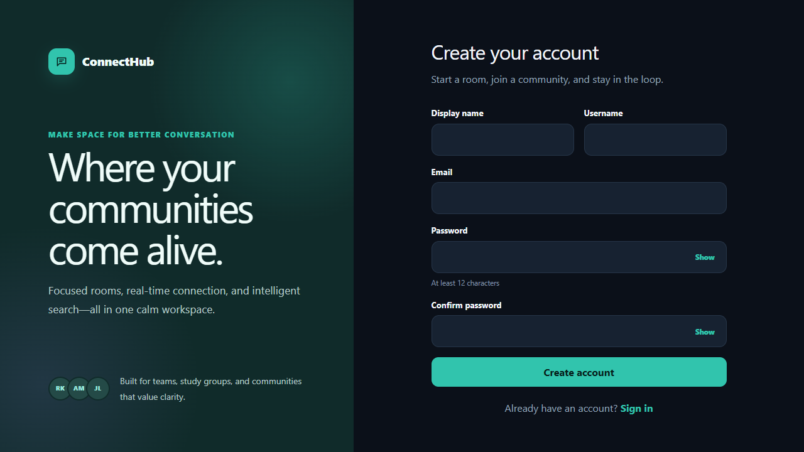
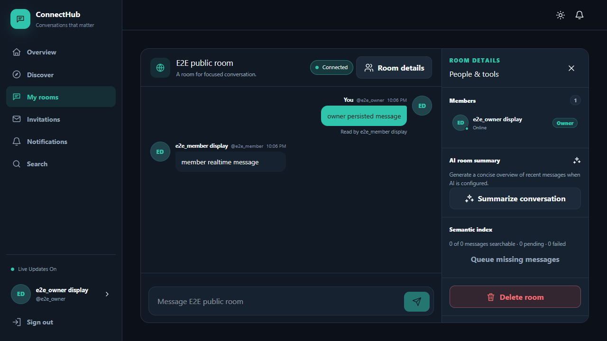
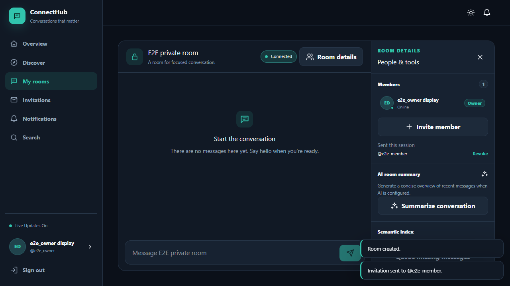
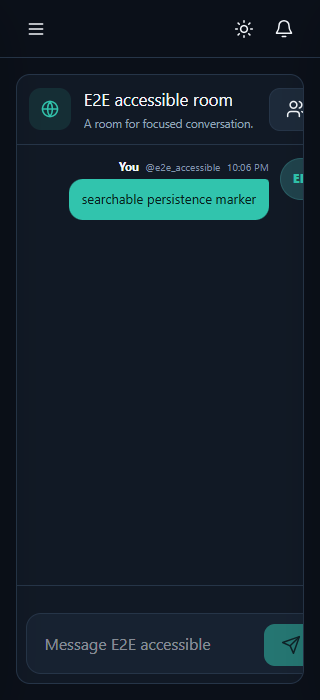

# ConnectHub engineering case study

## Product

ConnectHub is a full-stack multi-room messaging platform for teams, study groups, and communities. It combines durable PostgreSQL state with authenticated real-time delivery, private-room authorization, notifications, exact search, and optional Gemini summaries/semantic retrieval.

Live demo: <https://connecthub-web-w89e.onrender.com>

Source: <https://github.com/rehanmemon-ai/ConnectHub-Messaging_Platform>

## Architecture and engineering decisions

- React 19, TypeScript, Vite, Tailwind, and an Nginx same-origin reverse proxy.
- FastAPI modular monolith with async SQLAlchemy/Psycopg and Alembic-managed PostgreSQL.
- Opaque database sessions, CSRF double-submit validation, explicit Origin allowlists, backend-authoritative room membership, and plain-text React rendering.
- A single backend process intentionally owns WebSocket connections, presence, and process-local rate state. Horizontal scale requires an external coordination design and is not implied.
- Messages commit before broadcast and use client-generated UUIDs for idempotent retry.
- Optional AI is behind a provider boundary and explicit privacy gates. Versioned embedding profiles prevent incompatible vector spaces from mixing; durable jobs support retry/recovery.

## Evidence

The final local closeout passed 97 backend tests, 21 frontend tests, and 3 authenticated Playwright scenarios. Ruff, formatting, `pip check`, ESLint, TypeScript, production build, Alembic drift, and both npm audits passed. Playwright exercised independent users, public/private rooms, invitation acceptance, persistent/realtime messages, idempotency, search, accessibility, responsive layouts, and a bounded load smoke.

The offline evaluation corpus contains 120 fictional messages, 60 retrieval queries, and 18 summary fixtures. The deterministic K=5 exact baseline records P=.106667, recall=.177778, MRR=.483333, nDCG=.117554, and MAP=.177778. These are baseline measurements—not Gemini semantic quality. Live Gemini evaluation was not run because no approved key was available to the process, and production AI remains disabled.

## Deployment and limitations

Render hosts separate backend and frontend Docker services; Neon PostgreSQL supplies durable data in Singapore. Nginx keeps browser API/WebSocket traffic same-origin and verifies the backend TLS certificate. Free Render services may sleep and have ephemeral filesystems. The realtime manager is single-process, the semantic implementation performs bounded candidate cosine ranking over JSONB rather than a global vector index, and production AI is opt-in/off by default.

## Portfolio assets

The selected synthetic E2E screenshots below are included in the repository for GitHub review. The full-resolution evidence remains outside the repository under `D:\_Rehan\ConnectHub-Portfolio-Assets`; no production conversations or credentials are present.

Video capture was attempted but Playwright's FFmpeg binary was unavailable, so the storyboard below is the truthful handoff rather than a claimed recording.

## Résumé entry

**ConnectHub — Real-Time AI-Powered Messaging Platform** — Built and deployed a React/TypeScript + FastAPI/PostgreSQL multi-room chat application with secure cookie sessions, CSRF/Origin enforcement, authenticated WebSockets, private-room invitations, idempotent message delivery, notifications, exact search, and optional Gemini summaries/semantic retrieval. Added durable embedding jobs and reproducible offline evaluation; verified 97 backend tests, 21 frontend tests, and three authenticated multi-user Playwright scenarios. Deployed through Nginx on Render with Neon PostgreSQL while keeping AI processing explicit and disabled by default.

## Video edit guide

Suggested 60–90 second preview: entry/registration (0–8s), dashboard/public room (8–22s), two-user realtime exchange (22–38s), private invitation (38–52s), exact search (52–63s), responsive chat (63–75s), and an honest AI-disabled/privacy card plus links (75–90s). Suggested technical walkthrough chapters: architecture; auth/security; PostgreSQL model; room permissions; WebSocket lifecycle; messaging/idempotency; notifications/search; AI profiles/jobs/evaluation; tests; deployment/limitations. Add narration and captions during owner editing; do not present disabled AI as a live provider demonstration.
